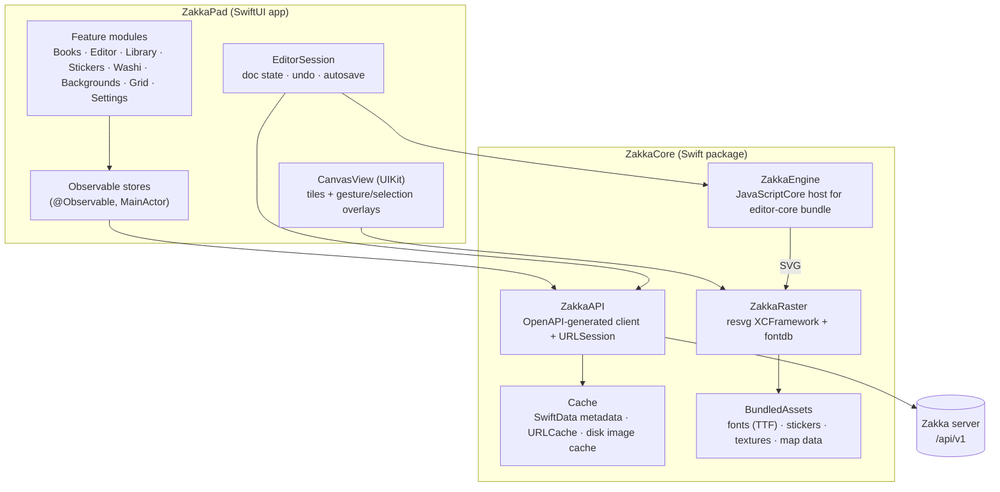

# Zakka for iPad — Native Client Plan

A native iPadOS 27 front end for [Zakka](https://github.com/JakeShirley/zakka). It connects to an existing Zakka server over its `/api/v1` HTTP API. The goal is full feature parity with the web app, using iPad-native controls: touch, Apple Pencil, keyboard and trackpad, Stage Manager windows, drag and drop, and the share sheet.

## 1. Decisions

| Topic | Decision | Rationale |
| --- | --- | --- |
| Platform | iPadOS 27 minimum, Xcode 27, Swift 6 language mode (strict concurrency), SwiftUI-first with UIKit where needed | The latest OS lets us use the 2027 SwiftUI APIs: reorderable containers, toolbar `visibilityPriority`/`toolbarOverflowMenu`, HTTP-cached `AsyncImage`, and lazy `@State`. We also get Liquid Glass styling. |
| Rendering | **Hybrid.** Zakka's `@zakka/editor-core` runs in **JavaScriptCore** for document logic and SVG generation. **resvg** rasterizes the SVG. Native UIKit/SwiftUI overlays handle selection, gestures, Pencil, and text editing. | `editor-core` is pure TypeScript with no DOM. It uses opentype.js, marked, d3-geo, topojson, and iconify. It already provides `renderPageDocumentSvg`, layouts, arrange plans, maps, and print-quality checks. Reusing it gives byte-level schema parity and visual parity with the web app and server export, and it avoids porting about 10k lines. |
| Connectivity | **Online-first with local caching.** Reads are cached for fast launch and browsing. Edits require a connection. | The server has no page revision or ETag (last write wins). Full offline editing would need conflict detection on the server first. |
| Server changes | **Not required for v1.** Recommended improvements are listed in §9. | Cookie sessions work with `URLSession`, and there are no CSRF or Origin checks that would block a native client. |

## 2. What the app must cover (parity inventory)

Based on `apps/web/src` and `packages/api-contract` in the Zakka repo.

| Area | Web features | API |
| --- | --- | --- |
| Auth | Register, log in, log out, session restore | `POST /auth/register`, `POST /auth/login`, `GET /auth/session`, `POST /auth/logout` (cookie `scrapbook_session`) |
| Books | List, create with a page-size preset (7×7 to 12×12 in, 300 units/in), open, settings (title, size, cover spread), delete, Shutterfly import | `/books`, `/books/{id}`, `PUT /books/{id}/pages`, `/books/{id}/assets` |
| Book editor | Page and spread view modes, filmstrip with multi-select and drag-reorder, prev/next navigation, page settings, resize-content picker, print warnings (<150 / <100 DPI), fullscreen, undo/redo with coalescing, 700 ms debounced autosave | `/pages/*` (PATCH replaces the whole document), `/books/*` |
| Layers | Photo, text, sticker, washi tape, map (no groups or shapes). Max 200 layers. Array order is z-order. Shared fields: `x, y, width, height, rotation, opacity, locked` | — |
| Photo | Fit cover/contain, normalized crop + aspect presets, pan/zoom/rotate/flip, border presets (mat/polaroid/film/paper), masks (ellipse/arch/diamond/ticket), shadow, filter presets + 6 adjustments, auto-enhance | `/assets/*` |
| Text | Markdown subset (bold/italic), about 220 bundled Google Fonts, size, color, horizontal and vertical alignment, stroke, shadow, glow, background, speech bubble | — |
| Stickers | Noto + Twemoji catalogs (bundled), custom sticker packs, favorites | `/sticker-packs/*`, `/custom-stickers/*` |
| Washi tape | 11 outlines, 6 patterns (incl. custom photo), tiling, custom tape library, creator | `/custom-washi-tapes/*` |
| Backgrounds | Built-in (patterns/paper/wood/fabric/sky) + custom uploads; per-page or spread-spanning; scale, rotation, color | `/backgrounds/builtin/*`, `/custom-backgrounds/*` |
| Maps | Vector and raster styles (OSM, Esri Topo via proxy), projections, markers, routes, highlighted countries, label font | `/map-tiles/{provider}/{z}/{x}/{y}` |
| Layouts & arrange | Layout picker (incl. Shutterfly-derived templates), align, distribute, grid arrange, layer inspector, context menu | — |
| Export | Book PDF, PNG (digital/print preset, DPI), ZIP of page PNGs | `POST /exports`, `GET /exports/{id}`, `GET /exports/{id}/content` |
| Library | Upload (JPEG/PNG/WebP/HEIC/TIFF/DNG, 20 MiB max), albums CRUD + membership, sort/filter, photo info | `/assets/*`, `/albums/*` |
| Image grid | Client-only collage tool: rows/cols/cell/gap/background, per-item span/fit, auto-arrange, PNG export | — (local only) |
| Settings | Theme, MCP access tokens (create/revoke), Shutterfly connect, About/system info, server logs, changelog | `/account/*`, `/integrations/shutterfly/*`, `/system/info`, `/logs` |

## 3. Architecture



### 3.1 Repository layout (zakka-ios)

```
ZakkaPad.xcodeproj
App/                      # @main, scenes, navigation, feature UI
  Features/{Auth,Books,Editor,Library,Stickers,WashiTape,Backgrounds,ImageGrid,Settings}
Packages/ZakkaCore/       # SwiftPM: ZakkaAPI, ZakkaModel, ZakkaEngine, ZakkaRaster, ZakkaCache
engine/                   # Node/TS build that bundles @zakka/editor-core for JavaScriptCore
  zakka/                  # git submodule → JakeShirley/zakka (pinned to a server-compatible tag)
  bridge.ts               # flat, JSON-in/JSON-out facade over editor-core
  build.mjs               # esbuild → engine.js (IIFE, ES2022, no DOM)
scripts/                  # asset extraction: WOFF→TTF, sticker SVGs, textures, OpenAPI fetch
Tests/                    # unit, snapshot, UI tests
```

### 3.2 ZakkaAPI (networking)
- Generate types and client from `GET /api/v1/openapi.json` with **swift-openapi-generator**, using a checked-in spec synced from the submodule. Hand-write the binary endpoints: uploads, asset content, and export download.
- `URLSession` with a dedicated `HTTPCookieStorage` per server profile. Store the `scrapbook_session` cookie value in the **Keychain** and restore it on launch. Call `GET /auth/session` to validate.
- Multi-server profiles: base URL, display name, and an ATS exception so `http://` LAN servers work. Reachability check via `GET /health`. Compare the server version against the engine's pinned editor-core version and warn on mismatch.
- Uploads use a background `URLSession` upload task (multipart field `file`). Photos come from `PhotosPicker`, drag and drop, Files, and the share extension. HEIC is uploaded as-is because the server transcodes it.
- Errors map `{error:{code,message,requestId}}` to typed errors. A 401 from any call routes to the sign-in sheet.

### 3.3 ZakkaEngine (editor-core in JavaScriptCore)
- `engine/bridge.ts` exposes a stable facade:
  - Schema: `parseDocument`, `normalizeDocument` (Zod validation + legacy sticker-ID normalization)
  - Editing: layer creation helpers, `applyLayout`, `listLayouts(canvas)`, arrange (`align`, `spread`, `grid`)
  - Text: markdown → runs, text layout metrics
  - Maps: geography detail, map content render
  - Quality: `photoQuality`, `bookPrintWarnings`, `autoEnhance(tones)`
  - Rendering: `renderPageSvg(doc, options)`, `renderLayerSvg(doc, layerId, options)`
- The engine runs on a dedicated serial actor with one `JSContext`. Calls are JSON-encoded, and Swift `Codable` mirrors `PageDocument`. Unknown fields are preserved by round-tripping raw JSON, so newer server fields aren't lost.
- href resolvers (`resolvePhotoHref`, `resolveBackgroundHref`, `resolveMapTileHref`, sticker hrefs) return `zakka-cache://…` keys. ZakkaRaster resolves these keys to local files, fetching them first if needed.
- Bundle size: load heavy modules lazily in separate JS chunks (10m map data, Shutterfly layouts, Noto icon set) via `evaluateScript` on demand.

### 3.4 ZakkaRaster (resvg)
- Build resvg's C API (Rust) as an XCFramework, wrapped in a Swift package. Its `fontdb` is preloaded with the bundled fonts converted to TTF (fonttools at build time).
- Rasterizes whole pages (thumbnails, filmstrip, library previews) and **individual layers** (editor tiles) at the current zoom × screen scale. Results go to an LRU memory cache plus a disk cache keyed by `(layer JSON hash, scale)`.
- Photo tiles: during pan, crop, and filter edits, use **Core Image** on the preview variant for live 120 Hz feedback. Swap to the resvg render when the gesture ends. (Same math as the editor-core transform; covered by golden tests.)

### 3.5 Editor canvas (native interaction)
- `CanvasView` is a UIKit `UIScrollView` with zoom, page or spread content, and one `CALayer` per document layer showing its rasterized tile. During gestures, apply the geometric transform to the tile with a `CATransform3D`, then re-rasterize when the gesture ends. This keeps direct manipulation fluid.
- **Selection overlay**: handles for resize, rotate, and crop. Multi-select by marquee (Pencil or trackpad drag), ⌘/⇧-click, or two-finger tap. Snapping guides use editor-core arrange bounds plus page center and edges, with light haptic ticks.
- **Gestures**: drag to move; pinch and rotate on the selection to scale and rotate; pinch on empty canvas to zoom the view. Double-tap a photo for pan/zoom-inside-frame. Double-tap text to edit. Long-press or right-click for the context menu (`UIContextMenuInteraction`).
- **Apple Pencil**: precise selection, hover previews of handles (Pencil Pro/M-series), squeeze to show the tool palette, and barrel-roll to rotate the selected layer.
- **Text editing**: an in-place `UITextView` (TextKit 2) overlay with registered fonts. The editing format bar has Bold and Italic only, which round-trips to the markdown subset. When editing ends, the overlay is replaced by the resvg tile so the result matches the export exactly.
- **Hardware keyboard** (`UIKeyCommand`, shown in the ⌘ discoverability HUD): ⌘Z/⇧⌘Z undo/redo, ⌫ delete, ⌘D duplicate, ⌘C/⌘V/⌘X, arrow nudge (⇧ for 10×), ⌘[ / ⌘] z-order, ⌘A select all, ⌘←/→ previous/next page, ⌘E export, Esc deselect/close panel.
- **Undo**: `EditorSession` keeps a document snapshot history with coalescing that mirrors `bookEditorHistory.ts` (it's a book-level stack across pages). It's exposed through `UndoManager` so shake-to-undo and three-finger gestures work.
- **Autosave**: 700 ms debounce per page, then `PATCH /pages/{id}` with the full document. Saves are serialized per page, and a status shows in the toolbar (Saved / Saving / Offline – changes held). Pending documents are stored on disk until they're saved. If the connection drops, editing becomes read-only after the in-flight change has been preserved.

## 4. iPad UX design

**App structure**: `NavigationSplitView` with a sidebar (Books, Photos, Stickers, Washi Tape, Backgrounds, Grid, Settings) and Liquid Glass chrome. It supports multiple windows: a book can open in its own scene (`openWindow`) so users can edit side by side with the Photos window in Stage Manager.

| Screen | Native treatment |
| --- | --- |
| Sign in / server | Onboarding sheet: server URL with a health check, then sign in or register. Saved server list. |
| Books | `LazyVGrid` of cover thumbnails (resvg first page) with context menus (Open in New Window, Settings, Export, Delete). Size-preset picker in a "New Book" sheet. Shutterfly import sheet with progress (async job polling). |
| Book editor | Full-screen canvas. Top toolbar: page/spread `Picker`, undo/redo, Add (Photo, Text, Sticker, Washi, Map, Layout), Export, and an overflow menu using `toolbarOverflowMenu`/`visibilityPriority`. Bottom **filmstrip** of page thumbnails with reorderable drag (new reorderable container API), multi-select, and add/duplicate/delete. Trailing **inspector** (`.inspector`) for the selected layer: Photo, Text, Washi, Map, Arrange, and Layers tabs; it becomes a sheet in compact width. Print warnings appear as a toolbar badge with a popover list. |
| Photo editor | Full-screen modal: crop with aspect presets, straighten dial, flip, pinch zoom/pan, filter preset strip with live Core Image previews, adjustment sliders, Auto Enhance button. |
| Pickers | Photos: library/album browser with search, sort, "hide used", multi-select, drag in from the Photos app. Stickers: searchable grid with pack tabs and favorites. Layouts: grid of layout previews filtered by photo count/orientation. All appear as popovers on regular width and sheets on compact. |
| Photos (library) | Grid with album chips, multi-select (two-finger drag-select), drag to albums in the sidebar, Get Info panel, upload from Photos/Files/drag and drop, progress toasts. |
| Stickers / Washi / Backgrounds | Gallery grids with search. Washi creator uses live preview, `ColorPicker`, and steppers/sliders. Custom uploads via `PhotosPicker`/Files. |
| Image grid | Native `Canvas`/Core Graphics compositor (no server state). Export through `ImageRenderer` to the share sheet or save to Photos. |
| Settings | `Form`: Appearance (map web themes to tint + light/dark), Integrations (MCP tokens with one-time secret copy, Shutterfly), About/system info, Logs viewer, Changelog. |
| Export | Sheet with format and preset/DPI, then progress, then share sheet (`ShareLink`) or Files export. |

Accessibility: VoiceOver labels for layers ("Photo, 3 of 7, rotated 5°") with accessibility custom actions for nudge, rotate, and reorder. Dynamic Type in chrome, Reduce Motion, and full keyboard navigation.

## 5. Bundled assets pipeline

The web client bundles these assets rather than serving them from the API, so the app must ship them too:

| Asset | Source in zakka repo | iPad treatment |
| --- | --- | --- |
| Google Fonts (~220 WOFF, 10 MB) | `packages/editor-core/vendor/fonts` | fonttools → TTF; register with `CTFontManager` (UI and TextKit) and load into the resvg fontdb |
| Noto / Twemoji stickers | `@iconify-json/noto`, twemoji | Served by the engine bundle as SVG; rasterized by resvg for pickers (pre-rendered thumbnail atlas at build) |
| Background textures (8 MB) | `vendor/backgrounds` | Also available via `/backgrounds/builtin/{slug}` (public cache). Ship thumbnails in the app; fetch full textures on demand. |
| Map geography (3.8 MB) | `vendor/maps` | Loaded lazily into the engine (10m detail only when needed) |

Licensing: carry over the font licenses, Noto (Apache-2.0), and Twemoji (CC-BY-4.0) attributions into Settings → About → Acknowledgements.

## 6. Caching (online-first)
- **SwiftData** holds the last-fetched metadata for books, pages (including the document JSON), albums, assets, packs, and tapes. The UI renders from cache immediately, then refreshes (stale-while-revalidate).
- **Images**: asset thumbnail (360px) and preview (2400px) variants plus map tiles go in the disk cache. The server sends `private, max-age=86400` without ETags, so the app uses URLCache plus content-addressed keys by asset ID because assets are immutable.
- **Rendered tiles**: resvg page and layer renders are cached by content hash.
- **Offline**: browse cached books and photos read-only, with an offline banner. Mutation controls are disabled.

## 7. Milestones

| # | Milestone | Scope | Exit criteria |
| --- | --- | --- | --- |
| M0 | Foundations | Xcode project, ZakkaCore package, CI (Xcode Cloud or GitHub Actions macOS runner), submodule + engine build, OpenAPI codegen, resvg XCFramework | `engine.js` loads in JSC; resvg renders a sample `renderPageDocumentSvg` output with bundled fonts |
| M1 | Connect & browse | Server profiles, auth, Keychain session, Books grid, read-only book viewer (page/spread), Photos library browsing, caching | Can sign in to a real server and view every existing book with correct rendering |
| M2 | Rendering parity | Golden-image test suite: the same docs rendered by the server export (PNG) vs ZakkaRaster; all layer types, effects, and backgrounds | ≤1% pixel difference (perceptual) across fixture corpus |
| M3 | Core editor | Canvas, selection, move/resize/rotate, snapping, undo/redo, autosave, add/delete/duplicate/reorder layers, context menu, keyboard shortcuts, filmstrip reorder, page add/delete, page/book settings | Edits round-trip; web app opens the iPad-edited pages unchanged |
| M4 | Photo & text | Photo picker, photo editor (crop, pan, filters, adjustments, auto-enhance, masks, borders, shadows), text editing with fonts and all effects | Feature checklist vs web passes |
| M5 | Decorations | Stickers + packs, washi tape + creator, backgrounds (per page/spread, custom uploads), layout picker, arrange panel, layer inspector | Feature checklist vs web passes |
| M6 | Maps | Map layer creation and controls: style, projection, view, markers, routes, countries, tiles via proxy | Feature checklist vs web passes |
| M7 | Library & management | Uploads (background), albums CRUD/membership, photo info, sticker/washi/background management screens | Feature checklist vs web passes |
| M8 | Export, grid, settings | Export jobs + share sheet, Image Grid, Settings (theme, MCP tokens, Shutterfly connect/import, About, Logs, Changelog) | Full parity matrix (§2) green |
| M9 | Polish & ship | Pencil Pro interactions, multi-window, accessibility audit, performance (200-layer page at 120 Hz drag), TestFlight | App Store / TestFlight build |

M2 runs alongside M3 onward. Rendering parity is the biggest technical risk, so it starts as soon as M1 can load documents.

## 8. Testing
- **Unit** (Swift Testing): API client decoding against fixtures captured from a real server, `PageDocument` Codable round-trip (unknown-field preservation), undo coalescing, autosave scheduler.
- **Engine contract tests**: run the bridge against the zakka repo's own editor-core test fixtures in JSC. This catches submodule bumps that change behavior.
- **Golden images**: a fixture corpus covering every layer kind and effect. CI renders each fixture with ZakkaRaster and compares it to a reference from the server's `/exports` (PNG, digital preset). The comparison uses a perceptual diff threshold.
- **UI tests** (XCUITest) against a Dockerized Zakka server (`ghcr.io/jakeshirley/zakka`) seeded per run: sign in → create book → add photo/text → reorder → export.
- **Performance**: XCTest metrics for page open time, drag frame rate, and memory on a 200-layer page.

## 9. Recommended server changes (zakka repo, optional but valuable)

| Change | Why | Priority |
| --- | --- | --- |
| Page `revision` + `If-Match` on `PATCH /pages/{id}` returning 409 on conflict | iPad and web (or the MCP assistant) can edit the same page concurrently; today it's last-write-wins. This is also a prerequisite for future offline editing. | High |
| Native token flow (roadmap **E06.6**): bearer access + rotating refresh tokens for REST | Cleaner than persisting cookie values; enables background upload re-auth | Medium |
| `ETag`/`Last-Modified` on asset content/variants | Better client cache validation | Low |
| Server-rendered page thumbnail endpoint | Faster Books grid on first launch (the client can render these itself, so this is optional) | Low |
| Change feed / `updatedAt`-since queries | Cheap refresh of cached lists | Low |

## 10. Risks & mitigations

| Risk | Mitigation |
| --- | --- |
| resvg vs server (Sharp/librsvg) rendering differences | Golden tests (M2). Feature-flag individual effects to the Core Image/Core Graphics fallback where they diverge. |
| JavaScriptCore performance for large docs/maps | Per-layer rendering, content-hash caching, lazy chunk loading, and engine work off the main thread. Profile early in M0. |
| editor-core version drift vs server | Pin the submodule to the server's release tag. Check `/health` version on connect, and warn or limit to read-only when the schema version is newer than the bundle. |
| Text editing fidelity (TextKit vs SVG `<text>`) | Editing overlay only while typing. Committed text is always rendered by the engine and resvg. |
| App Store: user-supplied server URLs, HTTP | Provide a demo server or review notes. ATS exceptions are scoped to user-entered local network hosts (`NSAllowsLocalNetworking`). |
| Bundle size (fonts + maps + stickers ≈ 25 MB+) | On-demand resources for map detail and the less-used font families |

## 11. Open questions
1. App name and bundle ID (working name: **ZakkaPad**).
2. Should a share extension ("Add to Zakka library") and a Photos-app editing extension be in v1 or later?
3. Should iPhone be supported later (same codebase, compact layouts), or is this iPad-only?
4. Are server-side changes in §9 in scope for this effort, or should they be tracked separately in the zakka repo?
